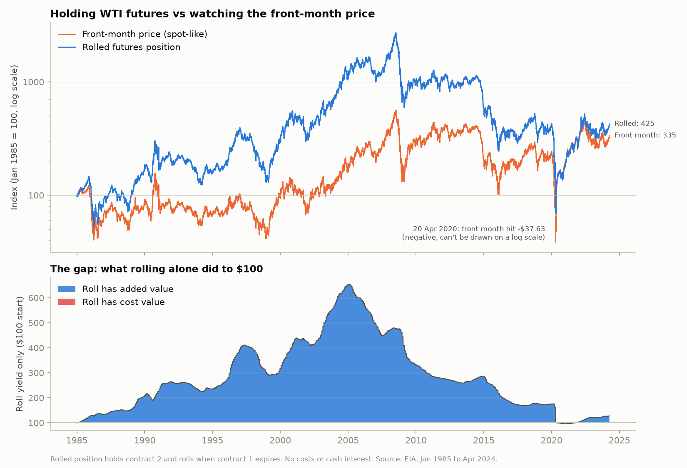
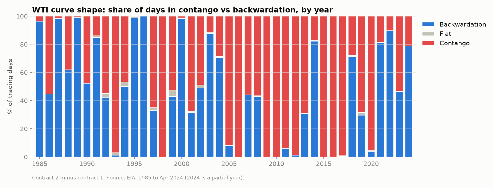
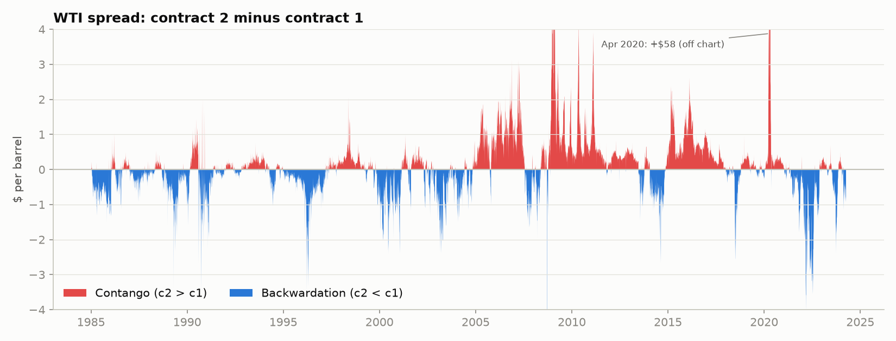
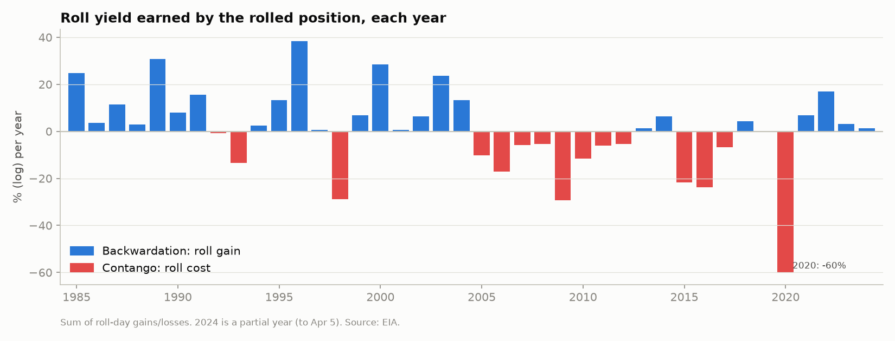
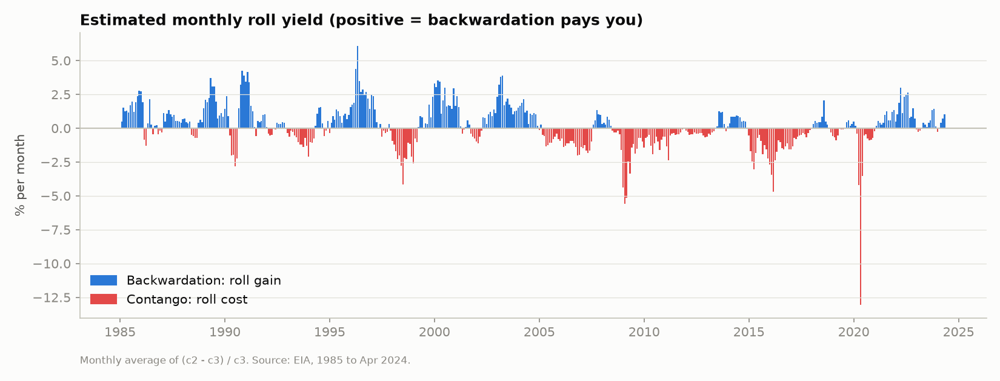
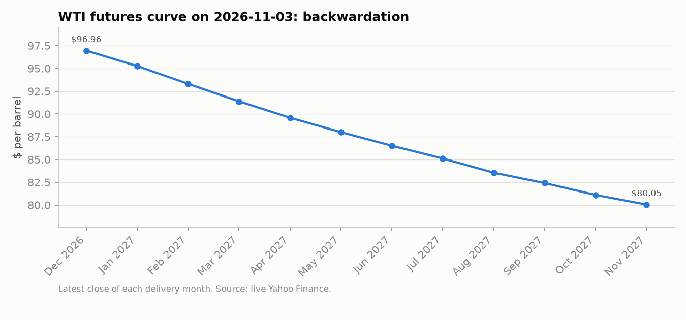

# WTI Roll Yield

**Question:** how much of the return from holding WTI crude oil futures comes from roll yield, and when does the curve flip between contango and backwardation?

**Data:** EIA daily settlement prices for WTI contracts 1–4, **January 1985 to 5 April 2024**, plus Yahoo Finance prices for the latest futures curve. New to these terms? Start with [docs/NOTES.md](docs/NOTES.md).

## Answer in four bullets
- **Roll yield was a big part of the return, but its sign depended on the era.** Holding contract 2 and rolling it every month turned **$1 into $4.25 (+325%)** over 1985–2024. Price changes alone would have made it $3.34. Roll yield multiplied that by **1.28 (+28%)**. That modest long-run figure hides two very different eras: rolling **doubled** the money in 1985–89 (+108%) and added +52% in the 1990s, then **cut it nearly in half** in the 2010s (−47%) and took −27% in 2020–24.
- **Contango and backwardation each held about half the time,** but in long stretches. WTI was in contango on **53.6%** of days and backwardation on **45.7%**. It was mostly backwardation before 2004 and almost always contango from 2005 to 2017; the longest stretch was **57 months, October 2008 to June 2013**. It flipped back to backwardation in 2021–22.
- **The sign checks out.** Contango months averaged **−0.95%** a month of roll yield and backwardation months **+1.31%**. By era: about **+8.6% a year** in 1985–2003, **−8.0%** in 2004–17 and **+1.9%** in 2018–24. Negative means you pay to roll.
- **Today (3 November 2026, live Yahoo data) the curve is in steep backwardation.** December 2026 is $96.96 and November 2027 is $80.05. If that shape lasted, a rolled position would earn about 2% a month from the roll. Our EIA history stops in April 2024, so this is a snapshot, not part of the backtest.



**Plain version: what happened to $1.** The price and roll parts **multiply**: price × roll = total.

| Period | $1 grew to | Price alone multiplied it by | Roll yield multiplied it by | Roll yield per year |
|---|---|---|---|---|
| **1985–2024** | **$4.25 (+325%)** | **×3.34 (+234%)** | **×1.28 (+28%)** | **+0.6%** |
| 1985–1989 | $1.73 (+73%) | ×0.83 (−17%) | ×2.08 (+108%) | +15.9% |
| 1990–1999 | $1.76 (+76%) | ×1.15 (+15%) | ×1.52 (+52%) | +4.3% |
| 2000–2009 | $3.37 (+237%) | ×3.23 (+223%) | ×1.04 (+4%) | +0.4% |
| 2010–2019 | $0.40 (−60%) | ×0.76 (−24%) | ×0.53 (−47%) | −6.2% |
| 2020–Apr 2024 | $1.03 (+3%) | ×1.42 (+42%) | ×0.73 (−27%) | −7.2% |

**Log version: the same numbers as log returns.** The price and roll parts **add**: price + roll = total. This is how the code does the split, and it is the clean way to say what *share* came from roll yield. Over the full period, roll yield is 24 of the 145 log points, about 17%.

| Period | Total (log) | From price (log) | From roll yield (log) | Roll yield per year (log) |
|---|---|---|---|---|
| **1985–2024** | **+145%** | **+120%** | **+24%** | **+0.6%** |
| 1985–1989 | +55% | −18% | +73% | +14.7% |
| 1990–1999 | +56% | +14% | +42% | +4.2% |
| 2000–2009 | +122% | +117% | +4% | +0.4% |
| 2010–2019 | −91% | −28% | −64% | −6.4% |
| 2020–Apr 2024 | +3% | +35% | −32% | −7.5% |

To convert, $1 grows to e^(log return): +145% log → e^1.45 ≈ $4.25. Small values are almost the same either way (+4% log ≈ +4% plain). Large ones are not: −64% log is a −47% plain loss, not −64%. Neither table includes interest on the unused cash or trading costs.

## When does the curve flip?




Labelling each month by its average spread gives **56 flips in 472 months**. Every stretch is listed in `results/curve_regimes.csv`. The longest:

| State | From | To | Months |
|---|---|---|---|
| Contango | 2008-10 | 2013-06 | 57 |
| Contango | 2014-11 | 2017-12 | 38 |
| Backwardation | 1995-01 | 1997-04 | 28 |
| Backwardation | 2021-01 | 2022-11 | 23 |
| Contango | 1997-05 | 1999-03 | 23 |

## Roll yield over time




The worst single roll was **22 April 2020**: sell June at $11.57, buy July at $18.69, a 38% loss in one day. This is why the "spot-like" front-month price and a real futures position can tell very different stories. It is also the story of why USO lags oil (see [NOTES](docs/NOTES.md#why-uso-lags-oil)).

## Today's curve


## Method
- **The rolled position** holds contract 2 and rolls into the next contract the day after contract 1 expires. Holding contract 2 instead of contract 1 avoids the expiring contract, so the 2020-04-20 −$37.63 price never touches the position.
- **Daily return:** `log(c2_t / c2_{t-1})` on normal days and `log(c2_t / c3_{t-1})` on roll days. Roll yield = `log(c2_{t-1} / c3_{t-1})` on roll days, so price + roll = total. The code is in [`src/roll.py`](src/roll.py) and is tested in [`tests/test_roll.py`](tests/test_roll.py).
- **Roll dates** come from the CME rule (trading ends 3 business days before the 25th). The prices agree with them on 90% of clear-cut days, against at most 33% for a date one or more days off ([details](docs/DATA_QUALITY.md#roll-date-check-milestone-3)).
- **Curve state:** contango if c2 > c1, backwardation if c2 < c1.
- **Monthly roll yield estimate:** the monthly average of `(c2 − c3) / c3`. It uses the same pair of contracts the position rolls between.

## Limits (read these)
- **The EIA history ends on 5 April 2024.** There are no daily contract 1–4 prices in this project from then until today. I did not stitch in another source. The latest curve comes from Yahoo and is a single snapshot.
- **Roll dates are approximate.** The weekday rule ignores exchange holidays, so a few rolls may be a day off.
- **Holding contract 2 is a simplification.** Real products such as USO and the S&P GSCI roll on their own schedules (general knowledge). The size of the roll yield depends on that choice.
- **Not a full total return:** no interest on the cash collateral and no trading costs.
- **Some blank cells:** about 7% of rows miss at least one contract (mostly 1986–2006). Those days are skipped, never filled in. See [docs/DATA_QUALITY.md](docs/DATA_QUALITY.md).

## Run it
```
python -m venv .venv
.venv\Scripts\activate            # Mac/Linux: source .venv/bin/activate
pip install -r requirements.txt
python src/m1_clean.py            # clean table + quality checks
python src/m2_curve.py            # contango/backwardation, roll yield estimate
python src/m3_rolled.py           # rolled position vs front month, latest curve
pytest                            # roll-math tests
```
`m3_rolled.py` tries to download the live curve from Yahoo Finance. If that fails, it uses the saved sample in `data/raw/`, and the chart title shows which date was used.

## Files
```
data/raw/        EIA contracts 1-4 sample, Yahoo curve sample
data/clean/      wti_c1_c4.csv (with flag columns)
src/             roll.py (the math), charts.py (chart style), m1/m2/m3 scripts
results/         CSV outputs (regimes, return split, roll-date check, latest curve)
charts/          PNGs used above
docs/            NOTES.md (plain English), DATA_QUALITY.md
```
